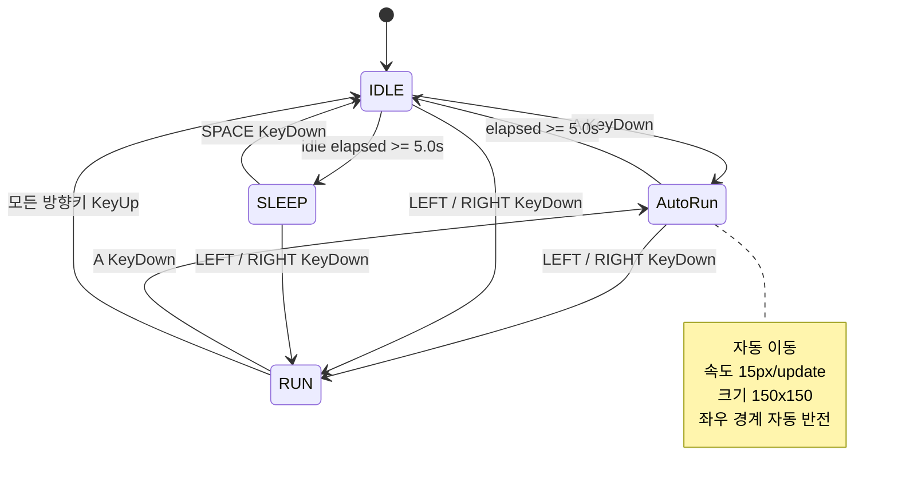

# DRILL11 AutoRun 기능 PRD

- 문서 상태: Draft
- 기준 문서: `PRE_PRD.md`
- 대상 실행 파일: `DRILL11.py`
- 주요 구현 파일: `boy.py`

## 1. 개요

소년 캐릭터의 기존 `IDLE`, `RUN`, `SLEEP` 상태에 `AutoRun` 상태를 추가한다. 사용자가 `IDLE` 상태에서 `A` 키를 누르거나, 방향키를 누른 채 `RUN` 중에 `A` 키를 누르면 소년은 `AutoRun`으로 전환된다. `AutoRun` 중에는 일반 달리기보다 빠르고 크게 표시되며, 화면 좌우 끝에서 방향을 자동으로 바꾼다.

`AutoRun`은 시작 후 5초가 지나면 `IDLE`로 종료된다. 5초가 지나기 전에 새로 왼쪽 또는 오른쪽 방향키가 입력되면 자동 달리기를 즉시 취소하고 해당 방향의 일반 `RUN` 상태로 전환한다. AutoRun 진입 전부터 누르고 있던 방향키의 반복 입력은 취소 입력으로 간주하지 않는다.

## 2. 목표

- `A` 키 하나로 자동 달리기를 시작할 수 있다.
- 자동 달리기 상태를 기존 상태와 명확히 분리한다.
- 자동 달리기의 속도 증가와 크기 확대를 시각적으로 즉시 인지할 수 있다.
- 화면 경계를 벗어나지 않고 좌우로 계속 왕복한다.
- 시간 경과 또는 방향키 입력에 따라 예측 가능한 상태로 복귀한다.
- 기능을 작고 검증 가능한 단위로 나누어 점증적으로 개발하고, 그 과정을 Git 커밋 이력으로 확인할 수 있다.

## 3. 범위

### 포함

- `AutoRun` 상태 클래스 추가
- `IDLE` 또는 방향키 입력 중인 `RUN`에서 `AutoRun`으로의 상태 전이
- 자동 이동, 속도 증가, 크기 확대
- 좌우 화면 경계에서 자동 방향 전환
- 5초 경과 후 `IDLE` 복귀
- 방향키 입력 시 `RUN` 전환
- 상태 전환 다이어그램 및 검증 시나리오
- 최소 10개 이상의 유효한 커밋으로 구성된 점증적 개발 이력

### 제외

- 새로운 캐릭터 이미지 또는 애니메이션 리소스 제작
- 충돌, 체력, 피격 및 실제 무적 판정 시스템
- `SLEEP` 상태의 기존 동작 변경
- 사운드 및 이펙트 추가
- 다중 캐릭터 지원

> 현재 프로젝트에는 충돌이나 피격 시스템이 없으므로 “무적”은 `AutoRun` 상태의 명칭과 표현으로 한정한다. 향후 피격 시스템이 추가되면 `AutoRun` 중 피해를 받지 않는 규칙을 별도로 연결한다.

## 4. 현재 동작

- 기본 상태는 `IDLE`이다.
- `IDLE`에서 왼쪽 또는 오른쪽 방향키를 누르면 `RUN`으로 전환한다.
- `RUN`에서 모든 방향키를 놓으면 `IDLE`로 돌아간다.
- `IDLE`이 5초 지속되면 `SLEEP`으로 전환한다.
- `SLEEP`에서 `Space` 키를 누르면 `IDLE`로, 방향키를 누르면 `RUN`으로 전환한다.
- 일반 달리기 속도는 업데이트 1회당 5픽셀이고 기본 렌더링 크기는 100×100픽셀이다.
- 캔버스 너비는 800픽셀이다.

## 5. 사용자 흐름

1. 소년이 `IDLE` 상태이거나 방향키를 누른 채 `RUN` 중이다.
2. 사용자가 `A` 키를 누른다.
3. 소년이 `AutoRun` 상태로 전환되어 현재 바라보는 방향으로 자동 이동한다.
4. 소년은 일반 달리기보다 빠르게, 더 큰 크기로 표시된다.
5. 소년이 화면 좌우 끝에 도달하면 반대 방향으로 자동 전환한다.
6. 다음 조건 중 먼저 발생한 조건에 따라 `AutoRun`이 종료된다.
   - 시작 후 5초 경과: `IDLE`로 전환
   - 왼쪽 또는 오른쪽 방향키 입력: 입력된 방향의 `RUN`으로 전환

## 6. 기능 요구사항

| ID | 요구사항 | 상세 기준 |
|---|---|---|
| FR-01 | AutoRun 진입 | `IDLE` 또는 `RUN` 상태에서 `A` 키의 `SDL_KEYDOWN` 이벤트가 발생하면 `AutoRun`으로 전환한다. `RUN`에서 진입할 때는 현재 이동 방향과 방향키 입력 상태를 유지한다. |
| FR-02 | 상태 클래스 | `boy.py`에 이름이 명확한 `AutoRun` 클래스를 추가한다. 자동 달리기의 진입, 갱신, 그리기 또는 이벤트 처리 책임을 이 클래스에 둔다. |
| FR-03 | 자동 이동 | `AutoRun` 동안 방향키가 눌리지 않아도 매 업데이트마다 `face_dir` 방향으로 이동한다. |
| FR-04 | 속도 증가 | `AUTO_RUN_SPEED`는 기존 `RUN_SPEED`의 3배인 업데이트 1회당 15픽셀을 기본값으로 한다. |
| FR-05 | 크기 확대 | 기존 100×100픽셀 이미지를 1.5배인 150×150픽셀로 렌더링한다. 기존 스프라이트 시트를 재사용한다. |
| FR-06 | 경계 반전 | 확대된 캐릭터 전체가 화면 안에 머물러야 한다. 중심점 `x`가 왼쪽 75픽셀 또는 오른쪽 725픽셀 경계에 도달하면 위치를 경계 안으로 보정하고 `face_dir`을 반대로 바꾼다. |
| FR-07 | 제한 시간 | `AutoRun` 진입 시간을 `time.monotonic()`으로 기록하고 경과 시간이 5.0초 이상이면 `IDLE`로 전환한다. |
| FR-08 | 수동 취소 | `AutoRun` 진입 후 새로 왼쪽 방향키를 누르면 `face_dir = -1`, 오른쪽 방향키를 누르면 `face_dir = 1`로 설정한 뒤 즉시 `RUN`으로 전환한다. 진입 전부터 누르고 있던 방향키의 반복 `KEYDOWN`은 취소로 처리하지 않으며, 해당 키의 `KEYUP`은 입력 상태만 해제한다. |
| FR-09 | 일반 RUN 복원 | 방향키로 `AutoRun`을 취소한 직후부터 속도와 크기는 일반 `RUN` 값인 5픽셀 및 100×100픽셀로 복원한다. 이후 키를 놓으면 기존 규칙대로 `IDLE`로 전환한다. |
| FR-10 | 중복 입력 | `AutoRun` 중 `A` 키를 다시 눌러도 타이머를 초기화하거나 상태를 재진입하지 않는다. |
| FR-11 | 상태별 A 키 | `RUN`에서 `A` 키를 누르면 현재 방향을 유지한 채 `AutoRun`으로 전환한다. `SLEEP`에서 누른 `A` 키는 무시한다. |
| FR-12 | 기존 조작 유지 | `Escape`, `Space`, 방향키 및 기존 `IDLE`/`RUN`/`SLEEP` 동작에 회귀 오류가 없어야 한다. |
| FR-13 | 최소 커밋 수 | AutoRun 기능 개발과 직접 관련된 유효한 Git 커밋을 최소 10개 이상 생성한다. 문서, 구현, 검증 변경을 포함할 수 있다. |
| FR-14 | 점증적 개발 | 각 커밋은 한 가지 명확한 목적을 가지며, 이전 커밋 위에 동작을 단계적으로 확장해야 한다. 가능한 모든 단계에서 프로그램은 실행 가능한 상태를 유지한다. |
| FR-15 | 커밋 품질 | 커밋 수를 늘리기 위한 빈 커밋, 의미 없는 공백 변경, 임시 파일 추가 또는 동일 변경의 반복은 유효한 커밋으로 인정하지 않는다. |

## 7. 상태 머신 설계

### 신규 전이

| 트리거 | 시작 상태 | 도착 상태 | 조건 |
|---|---|---|---|
| `start_auto_run` | `IDLE`, `RUN` | `AutoRun` | `A` 키 누름 |
| `auto_run_timeout` | `AutoRun` | `IDLE` | 경과 시간 ≥ 5.0초 |
| `cancel_auto_run` | `AutoRun` | `RUN` | 왼쪽 또는 오른쪽 방향키 누름 |

### 상태 다이어그램

## 8. 구현 설계 지침

### `AutoRun` 클래스 책임

- 상태 진입 시 시작 시각과 애니메이션 프레임을 초기화한다.
- 매 업데이트마다 프레임과 위치를 갱신한다.
- 확대된 크기로 달리기 애니메이션을 그린다.
- 좌우 경계를 검사하고 이동 방향을 반전한다.
- 5초 제한 시간 만료 여부를 판단한다.

### `Boy` 클래스 연동

- 상태 목록에 `AutoRun`을 등록한다.
- 신규 트리거 3개를 상태 머신에 등록한다.
- `A` 및 방향키 이벤트를 현재 상태에 맞게 전달한다.
- `update()`와 `draw()`가 `AutoRun` 동작을 호출하도록 분기한다.
- 확대 상태의 경계 계산에는 기본 반폭 50픽셀이 아닌 확대 반폭 75픽셀을 사용한다.

### 수정 파일 예상

- `boy.py`: `AutoRun` 클래스, 상수, 상태 전이, 이벤트·업데이트·렌더링 로직 추가
- `DRILL11.py`: 현재 이벤트를 `Boy`에 전달하고 있으므로 원칙적으로 변경하지 않는다. 통합 과정에서 필요한 최소 변경만 허용한다.

## 9. 점증적 개발 및 커밋 계획

### 개발 원칙

- AutoRun 기능 개발 시작점을 기준으로 관련 커밋을 최소 10개 이상 남긴다.
- 한 커밋에는 하나의 논리적인 변경만 포함한다.
- 각 커밋 직후 해당 단계에 맞는 실행 또는 정적 검사를 수행한다.
- 후속 커밋은 이전 단계의 동작을 유지하면서 기능을 확장한다.
- 최종 제출 전 커밋을 합치거나 재작성하여 유효 커밋 수가 10개 미만이 되지 않게 한다.
- 미완성 코드 때문에 실행이 중단되는 단계가 필요한 경우 기본 동작으로 안전하게 우회하고 다음 커밋에서 활성화한다.

### 권장 커밋 순서

아래 12단계는 권장 기준이다. 실제 커밋 메시지는 변경 내용에 맞게 조정할 수 있지만, 순서와 점증성은 유지한다.

| 순서 | 커밋 예시 | 변경 범위 | 단계별 검증 |
|---:|---|---|---|
| 1 | `docs: define AutoRun requirements` | PRE-PRD를 기반으로 PRD와 상태 전이 기준 정리 | 문서 요구사항 및 다이어그램 확인 |
| 2 | `refactor: centralize boy movement constants` | 속도, 크기, 캔버스 경계 관련 상수 정리 | 기존 `IDLE`/`RUN` 동작 확인 |
| 3 | `feat: add AutoRun state class` | 실행에 영향을 주지 않는 `AutoRun` 클래스 기본 구조 추가 | 프로그램이 기존과 동일하게 실행되는지 확인 |
| 4 | `feat: register AutoRun state transitions` | 상태 목록과 진입·종료 트리거 등록 | 상태 머신 초기화 오류가 없는지 확인 |
| 5 | `feat: enter AutoRun with A key` | `IDLE` 또는 `RUN`에서 `A` 키로 상태 진입 | 방향키를 누른 채 진입할 때 방향과 입력 상태가 유지되는지 확인 |
| 6 | `feat: animate AutoRun movement` | 입력 없이 현재 방향으로 자동 이동 | 무입력 자동 이동 확인 |
| 7 | `feat: increase AutoRun speed` | 자동 달리기 속도를 15픽셀로 적용 | 일반 `RUN`과 이동 거리 비교 |
| 8 | `feat: scale AutoRun sprite` | 자동 달리기 크기를 150×150픽셀로 확대 | 상태별 렌더링 크기 확인 |
| 9 | `feat: reverse AutoRun at boundaries` | 확대 크기를 고려한 경계 보정 및 방향 반전 | 좌우 끝 왕복과 화면 이탈 여부 확인 |
| 10 | `feat: stop AutoRun after timeout` | 5초 타이머와 `IDLE` 복귀 구현 | 5초 전후 상태 확인 |
| 11 | `feat: cancel AutoRun with direction keys` | 방향키 입력 시 해당 방향의 `RUN`으로 전환 | 좌우 입력 및 키 해제 동작 확인 |
| 12 | `test: verify AutoRun state regressions` | 통합 검증, 필요한 테스트·문서 보완 | AC-01부터 AC-08까지 최종 확인 |

### 커밋 이력 검증

- 기준 커밋 이후 AutoRun 관련 커밋 개수가 10개 이상이어야 한다.
- `git log --oneline <기준-커밋>..HEAD`로 커밋 개수와 순서를 확인한다.
- 각 커밋 메시지는 해당 단계의 변경 목적을 식별할 수 있어야 한다.
- 최종 브랜치에서 각 커밋이 동일 기능을 잘게 위장 분할한 것이 아니라 독립적인 개발 진전을 나타내야 한다.

## 10. 수용 기준

### AC-01: AutoRun 진입

- Given: 소년이 `IDLE` 상태이다.
- When: 사용자가 `A` 키를 누른다.
- Then: 즉시 `AutoRun` 상태가 되고 방향키 입력 없이 이동한다.
- Given: 소년이 방향키를 누른 채 `RUN` 상태이다.
- When: 방향키를 계속 누른 상태에서 사용자가 `A` 키를 누른다.
- Then: 현재 방향을 유지한 채 `AutoRun` 상태가 되고 속도가 3배로 증가하며 150×150픽셀로 확대된다.
- And: 계속 누르고 있던 방향키의 반복 입력이나 키 해제만으로 `AutoRun`이 취소되지 않는다.

### AC-02: 속도와 크기

- Given: 소년이 `AutoRun` 상태이다.
- Then: 같은 업데이트 횟수 기준으로 일반 `RUN`보다 3배 빠르게 이동하고 150×150픽셀로 표시된다.

### AC-03: 경계 자동 반전

- Given: 소년이 `AutoRun` 상태로 화면 끝에 도달한다.
- Then: 캐릭터가 화면 밖으로 잘리지 않고 반대 방향으로 계속 이동한다.

### AC-04: 시간 만료

- Given: 소년이 `AutoRun`에 진입했다.
- When: 방향키 입력 없이 5.0초가 경과한다.
- Then: `IDLE` 상태로 전환되고 크기와 이동 속도가 기본값으로 복원된다.

### AC-05: 방향키 취소

- Given: 소년이 `AutoRun` 상태이다.
- When: AutoRun 진입 후 5초 이내에 왼쪽 또는 오른쪽 방향키를 새로 누른다.
- Then: `AutoRun`이 즉시 취소되고 누른 방향을 바라보는 일반 `RUN` 상태가 된다.

### AC-06: 일반 RUN 종료

- Given: 방향키로 `AutoRun`을 취소하여 `RUN` 상태가 되었다.
- When: 눌렀던 방향키를 놓는다.
- Then: 기존 동작대로 `IDLE` 상태로 돌아간다.

### AC-07: 기존 상태 회귀 검사

- `IDLE`에서 5초 후 `SLEEP` 전환이 유지된다.
- `SLEEP`에서 `Space` 키로 깨어나는 동작이 유지된다.
- `IDLE` 또는 `SLEEP`에서 방향키로 일반 `RUN`에 진입하는 동작이 유지된다.
- `Escape` 키로 프로그램을 종료할 수 있다.

### AC-08: 점증적 커밋 이력

- Given: AutoRun 기능 개발이 완료되었다.
- When: 기능 개발 기준점 이후의 Git 이력을 확인한다.
- Then: AutoRun과 직접 관련된 유효 커밋이 최소 10개 이상 존재한다.
- And: 각 커밋은 한 가지 명확한 목적과 이전 단계 대비 검증 가능한 진전을 가진다.
- And: 빈 커밋이나 의미 없는 변경으로 커밋 수를 채우지 않았다.

## 11. 완료 조건

- `AutoRun` 클래스가 코드에 명시적으로 존재한다.
- 모든 신규 상태 전이와 기존 상태 전이가 정상 동작한다.
- 수용 기준 AC-01부터 AC-07까지 수동 검증을 통과한다.
- 수용 기준 AC-08의 최소 10개 유효 커밋과 점증적 개발 요건을 충족한다.
- 캐릭터가 어떤 상태에서도 화면 좌우 경계를 벗어나지 않는다.
- 실행 중 예외가 발생하지 않고 기존 그래픽 리소스를 정상 로드한다.
